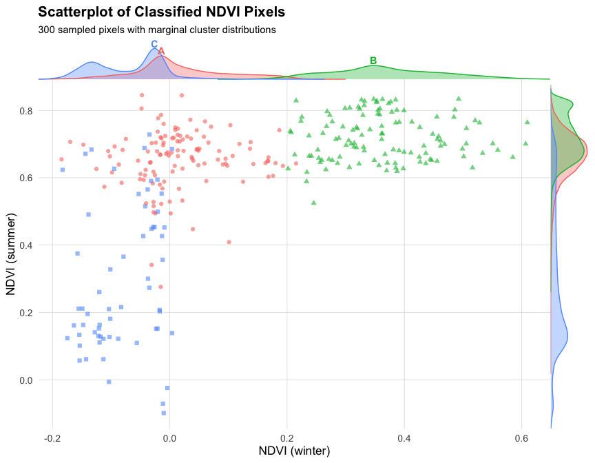
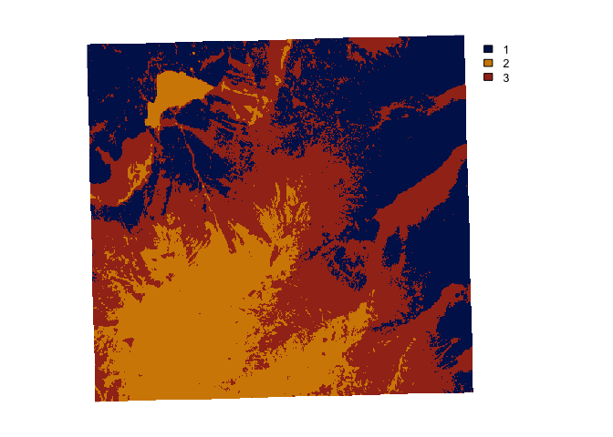
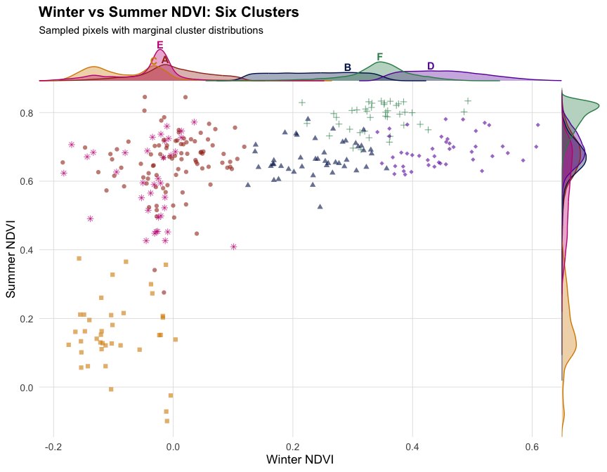

im.scatter: Scatterplot with Marginal Densities
================
Iris Nana Obeng
24 October 2026

# Overview

`im.scatter()` draws a spectral scatterplot with marginal density curves
attached to the top and right edges. Cluster identities are labelled
directly on the top density curve, following the marginal-density
approach described by Claus O. Wilke in Fundamentals of Data
Visualization.

The function is designed to work with the output of
`imageRy::im.classify()`. It reads the number of clusters directly from
the classified raster, so labels (`A`, `B`, `C`, …), colours and point
shapes adapt automatically to any number of clusters. The palette used
for the scatterplot is the exact same palette applied to the
classification map, ensuring the two figures can be read side by side
without a separate legend.

# Packages

``` r
library(imageRy)
library(terra)
library(ggplot2)
library(dplyr)
library(cowplot)
```

# The function

``` r
im.scatter <- function(
    band_x, band_y, classified,
    n_sample = 300, seed_sample = 1,
    colours = NULL, shapes = NULL, labels = NULL,
    title = "Scatterplot of Classified NDVI Pixels",
    subtitle = "300 sampled pixels with marginal cluster distributions",
    xlab = "NDVI (winter)", ylab = "NDVI (summer)",
    marginal_pt = 3 * 14
) {
  if (!terra::compareGeom(band_x, band_y, stopOnError = FALSE) ||
      !terra::compareGeom(band_x, classified, stopOnError = FALSE)) {
    stop("band_x, band_y and classified must share the same geometry.")
  }

  pixel_data <- data.frame(
    X = as.numeric(terra::values(band_x, mat = FALSE)),
    Y = as.numeric(terra::values(band_y, mat = FALSE)),
    Cluster = as.numeric(terra::values(classified, mat = FALSE))
  ) |>
    dplyr::filter(!is.na(X), !is.na(Y), !is.na(Cluster))

  if (nrow(pixel_data) == 0) stop("No valid pixels found.")

  # Rank clusters by abundance, then assign display labels A, B, C, ...
  cluster_sizes <- pixel_data |> dplyr::count(Cluster, sort = TRUE)
  n_clusters <- nrow(cluster_sizes)

  if (is.null(labels)) labels <- LETTERS[seq_len(n_clusters)]
  if (length(labels) != n_clusters) {
    stop(sprintf("Found %d clusters but %d labels supplied.",
                 n_clusters, length(labels)))
  }

  cluster_map <- cluster_sizes |>
    dplyr::mutate(Cluster_Label = labels)

  pixel_data <- pixel_data |>
    dplyr::left_join(
      cluster_map |> dplyr::select(Cluster, Cluster_Label),
      by = "Cluster"
    )

  # Matching colours to cluster IDs so the scatter matches the map exactly.
  if (is.null(colours)) {
    stored_pal <- attr(classified, "palette")

    if (is.null(stored_pal)) {
      stored_pal <- c(
        "#011959", "#D68A00", "#A3311D", "#2E8B57",
        "#6A0DAD", "#C71585", "#4682B4", "#B8860B",
        "#8B4513", "#3CB371"
      )
    }

    class_ids <- cluster_map$Cluster

    if (any(class_ids != as.integer(class_ids)) ||
        any(class_ids < 1) || any(class_ids > length(stored_pal))) {
      stop("Class IDs must be integers starting at 1 and have matching palette entries.")
    }

    # Keep each class's colour when assigning abundance-based labels.
    colours <- stats::setNames(
      stored_pal[as.integer(class_ids)],
      cluster_map$Cluster_Label
    )
  }

  if (length(colours) < n_clusters) {
    stop("Supply at least one colour for each cluster.")
  }

  if (is.null(shapes)) {
    base_shapes <- c(16, 17, 15, 18, 8, 3, 4, 1, 2, 0)
    shapes <- stats::setNames(
      rep(base_shapes, length.out = n_clusters), labels
    )
  }

  set.seed(seed_sample)

  plot_data <- if (nrow(pixel_data) > n_sample) {
    dplyr::slice_sample(pixel_data, n = n_sample)
  } else {
    pixel_data
  }

  main_plot <- ggplot2::ggplot(plot_data, ggplot2::aes(X, Y)) +
    ggplot2::geom_point(
      ggplot2::aes(colour = Cluster_Label, shape = Cluster_Label),
      size = 1.8, alpha = 0.6
    ) +
    ggplot2::scale_colour_manual(values = colours) +
    ggplot2::scale_shape_manual(values = shapes) +
    ggplot2::labs(
      title = title, subtitle = subtitle, x = xlab, y = ylab
    ) +
    ggplot2::theme_minimal(base_size = 13) +
    ggplot2::theme(
      legend.position = "none",
      plot.title = ggplot2::element_text(face = "bold"),
      plot.subtitle = ggplot2::element_text(size = 11),
      panel.grid.minor = ggplot2::element_blank(),
      panel.grid.major = ggplot2::element_line(
        linewidth = 0.3, colour = "grey88"
      )
    )

  x_dens <- pixel_data |>
    dplyr::group_by(Cluster_Label) |>
    dplyr::group_modify(~ {
      d <- stats::density(.x$X, na.rm = TRUE)
      data.frame(value = d$x, density = d$y)
    }) |>
    dplyr::ungroup()

  y_dens <- pixel_data |>
    dplyr::group_by(Cluster_Label) |>
    dplyr::group_modify(~ {
      d <- stats::density(.x$Y, na.rm = TRUE)
      data.frame(value = d$x, density = d$y)
    }) |>
    dplyr::ungroup()

  x_peaks <- x_dens |>
    dplyr::group_by(Cluster_Label) |>
    dplyr::filter(density == max(density)) |>
    dplyr::ungroup()

  y_span <- diff(range(x_dens$density, na.rm = TRUE))

  x_peaks <- x_peaks |>
    dplyr::mutate(
      label = Cluster_Label,
      hjust = 0.5,
      vjust = 0,
      nudge_x = 0,
      nudge_y = y_span * 0.05
    )

  xdens <- cowplot::axis_canvas(main_plot, axis = "x") +
    ggplot2::geom_ribbon(
      data = x_dens,
      ggplot2::aes(
        x = value, ymin = 0, ymax = density,
        fill = Cluster_Label, group = Cluster_Label
      ),
      alpha = 0.35
    ) +
    ggplot2::geom_line(
      data = x_dens,
      ggplot2::aes(
        x = value, y = density,
        colour = Cluster_Label, group = Cluster_Label
      ),
      linewidth = 0.5
    ) +
    ggplot2::geom_text(
      data = x_peaks,
      ggplot2::aes(
        x = value + nudge_x,
        y = density + nudge_y,
        label = label,
        hjust = hjust,
        vjust = vjust,
        colour = Cluster_Label
      ),
      size = 11 / ggplot2::.pt,
      fontface = "bold",
      inherit.aes = FALSE
    ) +
    ggplot2::scale_colour_manual(values = colours, guide = "none") +
    ggplot2::scale_fill_manual(values = colours, guide = "none") +
    ggplot2::scale_y_continuous(
      limits = c(0, max(x_dens$density) * 1.25),
      expand = c(0, 0)
    ) +
    ggplot2::coord_cartesian(clip = "off")

  ydens <- cowplot::axis_canvas(
    main_plot, axis = "y", coord_flip = TRUE
  ) +
    ggplot2::geom_ribbon(
      data = y_dens,
      ggplot2::aes(
        x = value, ymin = 0, ymax = density,
        fill = Cluster_Label, group = Cluster_Label
      ),
      alpha = 0.35
    ) +
    ggplot2::geom_line(
      data = y_dens,
      ggplot2::aes(
        x = value, y = density,
        colour = Cluster_Label, group = Cluster_Label
      ),
      linewidth = 0.5
    ) +
    ggplot2::scale_colour_manual(values = colours, guide = "none") +
    ggplot2::scale_fill_manual(values = colours, guide = "none") +
    ggplot2::scale_y_continuous(
      limits = c(0, max(y_dens$density) * 1.05),
      expand = c(0, 0)
    ) +
    ggplot2::coord_flip()

  p1 <- cowplot::insert_xaxis_grob(
    main_plot, xdens, grid::unit(marginal_pt, "pt"),
    position = "top", clip = "off"
  )

  p2 <- cowplot::insert_yaxis_grob(
    p1, ydens, grid::unit(marginal_pt, "pt"),
    position = "right", clip = "off"
  )

  cowplot::ggdraw(p2)
}
```

# Loading NDVI data from imageRy

The four Sentinel-2 NDVI scenes bundled with `imageRy` are used here.
Each represents a different season in 2020, so the scatterplot explores
how vegetation greenness changes across the year.

``` r
ndvi_winter <- im.import("Sentinel2_NDVI_2020-02-21.tif")
ndvi_spring <- im.import("Sentinel2_NDVI_2020-05-21.tif")
ndvi_summer <- im.import("Sentinel2_NDVI_2020-08-01.tif")
ndvi_autumn <- im.import("Sentinel2_NDVI_2020-11-27.tif")

ndvi_stack <- c(
  ndvi_winter, ndvi_spring, ndvi_summer, ndvi_autumn
)

names(ndvi_stack) <- c("Winter", "Spring", "Summer", "Autumn")
```

# Shared palette

A single palette is defined once and used for both the classification
map and the scatterplot. This ensures that a cluster shown in one colour
in the scatter is the exact same colour on the map.

``` r
cluster_colours <- c(
  "#011959", "#D68A00", "#A3311D", "#2E8B57", "#6A0DAD",
  "#C71585", "#4682B4", "#B8860B", "#8B4513", "#3CB371"
)
```

# Classify the NDVI data

`imageRy::im.classify()` accepts at most three bands, so the clustering
uses winter, spring and summer NDVI. The autumn scene is loaded but does
not contribute to the cluster assignment.

The palette is passed to `im.classify(custom_colors = ...)` so the map’s
legend uses the same colours as the scatterplot. It is then attached to
the returned raster as an attribute, so `im.scatter()` can read it back
directly.

``` r
ndvi_for_clustering <- c(
  ndvi_winter, ndvi_spring, ndvi_summer
)

names(ndvi_for_clustering) <- c("Winter", "Spring", "Summer")

set.seed(42)
classified <- im.classify(
  ndvi_for_clustering,
  num_clusters = 3,
  seed = 42,
  do_plot = FALSE,
  custom_colors = cluster_colours[1:3]
)

# Store the palette alongside the classified raster.
attr(classified, "palette") <- cluster_colours[1:3]
```

# Scatterplot

The scatterplot displays winter NDVI on the x-axis and summer NDVI on
the y-axis. Pixels along the 1:1 line show little seasonal change, while
pixels above or below it gain or lose vegetation between winter and
summer.

``` r
figure <- im.scatter(
  band_x = ndvi_stack[["Winter"]],
  band_y = ndvi_stack[["Summer"]],
  classified = classified,
  title = "Winter vs Summer NDVI by Cluster",
  subtitle = "Sampled pixels with marginal cluster distributions",
  xlab = "Winter NDVI",
  ylab = "Summer NDVI"
)
```



``` r
ggsave(
  "ndvi_scatterplot_marginals.png",
  plot = figure,
  width = 9,
  height = 7,
  dpi = 300
)
```

# Classification map comparison

The chunk below draws the classification map so it can be compared
directly with the scatterplot.

``` r
im.classify(
  ndvi_for_clustering,
  num_clusters = 3,
  seed = 42,
  do_plot = TRUE,
  custom_colors = cluster_colours[1:3]
)
```



    ## class       : SpatRaster 
    ## size        : 528, 555, 1  (nrow, ncol, nlyr)
    ## resolution  : 10, 10  (x, y)
    ## extent      : 648990, 654540, 5120440, 5125720  (xmin, xmax, ymin, ymax)
    ## coord. ref. : WGS 84 / UTM zone 32N (EPSG:32632) 
    ## source(s)   : memory
    ## varname     : file138375b88743 
    ## name        : Winter 
    ## min value   :      1 
    ## max value   :      3

# Flexibility: six clusters

`im.scatter()` reads the cluster count from the `classified` raster and
generates labels, colours and shapes accordingly. The pipeline below
repeats the same workflow with `num_clusters = 6` no changes to the
function or the call site are required. With more clusters, the density
curves on the top marginal begin to overlap, but each cluster remains
distinguishable by colour and shape.

``` r
classified_6 <- im.classify(
  ndvi_for_clustering,
  num_clusters = 6,
  seed = 42,
  do_plot = FALSE,
  custom_colors = cluster_colours[1:6]
)

attr(classified_6, "palette") <- cluster_colours[1:6]

figure_6 <- im.scatter(
  band_x = ndvi_stack[["Winter"]],
  band_y = ndvi_stack[["Summer"]],
  classified = classified_6,
  title = "Winter vs Summer NDVI: Six Clusters",
  subtitle = "Sampled pixels with marginal cluster distributions",
  xlab = "Winter NDVI",
  ylab = "Summer NDVI"
)

figure_6
```



# Interpretation

The central scatterplot shows the relationship between winter and summer
NDVI for sampled pixels. Pixels near the 1:1 line have similar NDVI
values in the two seasons; pixels above or below it differ between
seasons, indicating vegetation gain or loss.

The top marginal density shows winter NDVI distributions within
clusters. The right marginal shows summer NDVI distributions. Letters
identify clusters in order of abundance: A is the largest cluster, B the
second largest, and so on.

The clusters are descriptive results of unsupervised classification;
they should not automatically be interpreted as validated land-cover
classes.

# Colour consistency

The palette is passed to `im.classify()` via `custom_colors` and
attached to the classified raster. `im.scatter()` matches the palette
entries to the original cluster IDs before displaying the
abundance-based labels. This keeps colours consistent across the map and
scatterplot: a cluster shown in one colour in the scatter is the exact
same colour on the classification map.

# Author

Iris Nana Obeng
